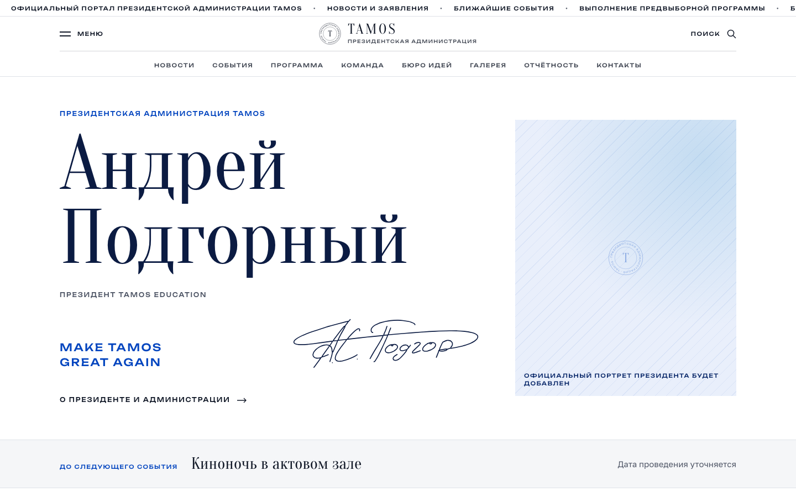

# TAMOS Student Government

The official website of the student government (presidential administration) of TAMOS Education, Almaty. Students read news, follow upcoming events, and track how every point of the election programme is being delivered. The president's team publishes everything through an admin panel, without touching code.

**Live site:** https://tamos-student-government.vercel.app · **Admin panel:** `/admin`



The interface and inline code comments are in Russian, the language of the school community and of the student team that will maintain the site.

## Features

**Public site**

- Home page: the president, the next event with a live countdown, latest news, upcoming events, programme progress and the team.
- News with filter tabs by category, search and pagination.
- Events as a list or a month calendar. Status updates automatically from the date: "soon" two weeks before, "completed" after the end. A countdown appears only once the date is officially confirmed.
- Programme tracker: every election promise has a status, a dated history of changes and supporting evidence; totals are computed from the data.
- Team, Ideas Bureau (student project proposals), photo gallery, reports, campaign archive, site-wide search.
- Contact form that stores messages for the administration (validation, honeypot and timing trap against bots).
- Responsive layout, WCAG 2.1 AA checked with axe in CI, Open Graph images generated per page, sitemap, robots, favicon and Apple touch icon.

**Admin panel** (`/admin`)

- Email and password sign-in; passwords are stored only as salted PBKDF2 hashes. Accounts lock for 10 minutes after 5 failed attempts.
- Roles: administrator (everything) and editor (only the sections the administrator grants).
- Create, edit and delete news, events, programme items, team members, reports, albums; image upload with focal point and automatic responsive sizes.
- Drafts and publishing with version history; **Preview** opens the real page with the latest draft, visible only to signed-in staff.
- Contact-form inbox with statuses (new, in progress, answered).
- Every save invalidates the page cache, so changes are live immediately.

## Stack

| Layer | Technology |
|---|---|
| Framework | Next.js 16 (App Router, React Server Components, Server Actions), React 19, TypeScript |
| Content and admin | Payload CMS 3, embedded in the same Next.js app |
| Database | PostgreSQL (Neon in production) with versioned migrations in `src/migrations` |
| Files | Vercel Blob in production, local disk when self-hosted |
| Styling | Tailwind CSS 4 with design tokens, Motion for small animations |
| Quality | ESLint, TypeScript strict, Vitest, Playwright + axe-core, GitHub Actions |
| Hosting | Vercel (Frankfurt region); Docker image for self-hosting |

### Why Payload CMS and PostgreSQL

The brief needed authentication with hashed passwords, CRUD for several content types, image uploads, drafts with preview, roles and an audit trail. Payload provides all of this as code-defined collections inside the same Next.js app, so there is one repository, one deployment and one TypeScript type system from the database to the page. Writing the same with NextAuth + Prisma + a hand-made admin UI would have meant several thousand more lines to maintain for a student team.

PostgreSQL was chosen over SQLite because the site runs on serverless functions (Vercel), where a local SQLite file is not persistent between requests. Neon's free tier gives a managed Postgres with point-in-time restore, and any standard Postgres works without code changes, so the school can move the database to its own server or to Supabase at any time.

## Project structure

```
src/
  app/(frontend)/   public site: pages, layout, styles, contact server action
  app/(payload)/    admin panel and REST API
  app/next/         draft preview on/off routes
  collections/      content schemas: news, events, programme, team, messages, users…
  globals/          site settings, home page, Ideas Bureau, campaign archive
  components/site/  UI components (header, cards, calendar, countdown, forms)
  lib/              data access, event status rules, calendar, filters, formatting
  hooks/            cache invalidation after edits
  migrations/       database migrations for production
  seed/             demo content and the admin bootstrap script
tests/unit/         Vitest
tests/e2e/          Playwright smoke and accessibility tests
docs/               design system
```

The visual language (colours, typography, grid, components, photo rules) is documented in [docs/design-system.md](docs/design-system.md).

## Running locally

Requirements: Node.js 20.18+ and PostgreSQL 14+ (or Docker, see below).

```bash
cp .env.example .env        # set DATABASE_URL and PAYLOAD_SECRET
npm install
npm run dev                 # http://localhost:3000, admin at /admin
```

In development Payload creates the schema automatically. To fill an empty database with demo content and create an administrator:

```bash
npm run seed:all
ADMIN_EMAIL=you@example.com ADMIN_PASSWORD='a-long-password' npm run create-admin
```

All demo records are flagged as demo and show a "Demo" badge. They can be hidden in Site settings or removed with `npm run demo:clear -- --yes`.

### Scripts

| Command | What it does |
|---|---|
| `npm run dev` / `build` / `start` | Next.js development server, production build, production server |
| `npm run lint` / `typecheck` | ESLint and TypeScript checks |
| `npm test` | Unit tests (event status rules, calendar, contact validation, links) |
| `npm run test:e2e` | Playwright smoke tests on desktop and mobile, including axe accessibility checks |
| `npm run migrate` / `migrate:create -- name` | Apply or create database migrations |
| `npm run create-admin` | Create an administrator from `ADMIN_EMAIL` / `ADMIN_PASSWORD`, or reset that account's password |
| `npm run seed:all` | Demo content: programme, events, news, team |

### Tests

```bash
npm run build && npm run start     # in one terminal
E2E_ADMIN_EMAIL=… E2E_ADMIN_PASSWORD=… npm run test:e2e
```

The smoke suite covers the home page, a news article, the events calendar, the contact form, redirects from old URLs, sign-in to the admin panel, creating and publishing a news item, and checking that a draft is hidden from visitors but visible in preview. GitHub Actions runs lint, types and unit tests on every push, then builds the site against a fresh Postgres service, seeds it and runs the Playwright suite.

## Deployment on Vercel

The production build runs migrations first (`npm run ci`, set in `vercel.json`).

1. Create a Postgres database (Neon through the Vercel Marketplace) and a Vercel Blob store; both inject their variables into the project.
2. Add `PAYLOAD_SECRET` (`openssl rand -hex 32`), `NEXT_PUBLIC_SITE_URL` and `NEXT_PUBLIC_SITE_TIMEZONE=Asia/Almaty`.
3. Deploy, then create the first administrator against the production database:

   ```bash
   vercel env pull .env.production.local --environment=production
   set -a; source .env.production.local; set +a
   ADMIN_EMAIL=you@example.com ADMIN_PASSWORD='a-long-password' npm run create-admin
   ```

### Caching

Public pages are served from the CDN with incremental static regeneration: a page is fresh for 60 seconds and is never served older than one hour. Any save in the admin panel revalidates the whole site immediately (`src/hooks/revalidate.ts`). List filters such as `/events?status=soon` are rewritten to cached paths (`src/lib/filters.ts`), so filtered views are cached too. Search, the admin panel and preview are always dynamic.

## Moving to the school's hosting

The app is a standard Node.js server plus PostgreSQL; nothing in the code depends on Vercel.

**1. Database.** Create a PostgreSQL 14+ database on the school server (or keep Neon). Copy the data:

```bash
pg_dump --no-owner --no-acl "$OLD_DATABASE_URL" > tamos.sql
psql "$NEW_DATABASE_URL" < tamos.sql
```

**2. Files.** If Vercel Blob stays, nothing changes. To keep uploads on the server, leave `BLOB_READ_WRITE_TOKEN` empty; new uploads go to `./media` and `./documents`. Existing files can be downloaded from the Blob store and re-uploaded through the admin panel.

**3. Run the site.** With Docker:

```bash
cp .env.example .env    # PAYLOAD_SECRET, NEXT_PUBLIC_SITE_URL, optional POSTGRES_PASSWORD
docker compose up -d    # Postgres + site on port 3000; first start builds the app (2–3 min)
docker compose exec app npm run create-admin   # with ADMIN_EMAIL / ADMIN_PASSWORD in .env
```

Without Docker: `npm ci && npm run migrate && npm run build && npm run start` under a process manager (systemd or pm2), Node.js 20.18+, at least 2 GB RAM for the build.

**4. Domain and HTTPS.** Point a subdomain such as `student.tamos-education.kz` to the server (A record) or to Vercel (CNAME `cname.vercel-dns.com`). On a server, put Nginx or Caddy in front of port 3000 for TLS. Set `NEXT_PUBLIC_SITE_URL` to the final address and redeploy: it is used for canonical links, the sitemap, Open Graph images and the admin panel's CSRF protection.

**5. Environment variables.**

| Variable | Required | Purpose |
|---|---|---|
| `DATABASE_URL` | yes | PostgreSQL connection string |
| `PAYLOAD_SECRET` | yes | Signs sessions; changing it signs everyone out |
| `NEXT_PUBLIC_SITE_URL` | yes | Public address without a trailing slash |
| `NEXT_PUBLIC_SITE_TIMEZONE` | no | Defaults to `Asia/Almaty` |
| `BLOB_READ_WRITE_TOKEN` | no | Vercel Blob for uploads; local disk if empty |
| `ADMIN_SETUP_TOKEN` | no | Protects first-user sign-up on an empty database |

**6. Backups.** Neon keeps point-in-time restore for the free-tier history window. On a self-hosted server, add a nightly dump and keep at least 14 days:

```bash
# crontab -e
0 3 * * * pg_dump --format=custom "$DATABASE_URL" > /backups/tamos-$(date +\%F).dump && find /backups -name 'tamos-*.dump' -mtime +14 -delete
```

Restore with `pg_restore --clean --no-owner -d "$DATABASE_URL" /backups/tamos-YYYY-MM-DD.dump`. Back up the `media/` and `documents/` folders together with the database if files are stored locally.

## Licence

MIT © Kirill Vozianov
